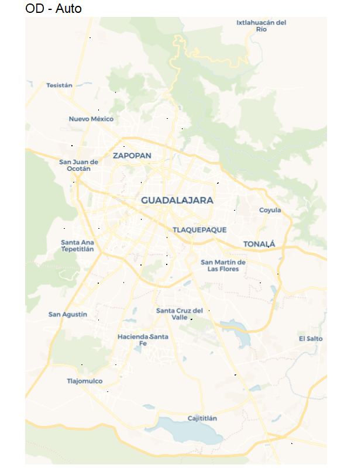

# Rutas por modalidad Matriz origen-destino de viajes (pares con más de 5,000 viajes)

La matriz incluye los pares origen-destino que tienen más de 5,000 viajes según el factor de expansión (ponderador). Cada par se ruteó en tres modalidades: Caminando, Auto y Bicicleta. La columna modalidad indica a cuál corresponde cada registro, y para cada una se incluye la geometría de la ruta (geom), la distancia (distance, en km) y la duración del recorrido (duration, en minutos).
En total, la matriz suma 9,622,953 viajes, distribuidos así:

Categoría	ViajesDe 5,000 a 10,000	1,035,824
De 10,000 a 20,000	1,490,816
De 20,000 a 50,000	1,629,396
De 50,000 a 100,000	951,443
Más de 100,000	4,515,474

Variables principales:

nombre_origen / ori y nombre_destino / dest: nombre y clave de la zona de origen y de destino.
viaje: identificador del par origen-destino.
ponderador: número de viajes expandidos.
categoria: rango de viajes del par.
promedio_x/y_origen y promedio_x/y_destino: coordenadas de los centroides (WGS84).
modalidad, distance, duration y geom: modalidad, distancia, tiempo y trazo de la ruta.

Nota: los viajes intrazonales (con el mismo origen y destino, por ejemplo 02F-02F) tienen distancia y duración de 0.

Las unidades: las puse en km y minutos porque así suelen salir de OSRM.
Auto, bicicleta y caminando están en la misma tabla por lo que para conocer los viajes es necesario filtrar por una modalidad y que no se repitan

